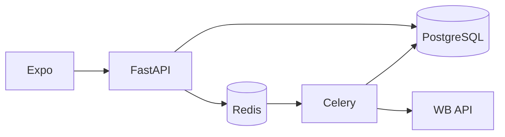

# Архитектура PERK API

Актуально на 4 ноября 2026. Модульный монолит: FastAPI, PostgreSQL,
Redis и Celery. Мобильный клиент — соседний проект `../FRONT` на Expo SDK 58.
Один бек используется всеми клиентами. Для Ozon готово подключение ключа;
импорт данных — следующий этап, см. [OZON.md](OZON.md).

```text
app/
  api/                   сборка маршрутов и проверки доступности
  core/                  настройки, ошибки и журналы
  db/                    модели, сессии, actor RLS и общие tenant-фильтры
  security/              шифрование и операции с паролями
  integrations/          HTTP-клиенты маркетплейса, лимиты, доставка кодов
  modules/
    auth/                регистрация, вход, MFA и сессии
    accounts/            пространства, магазины, роли и приглашения
    audit/               журнал значимых действий
    sync/                фоновые загрузки, расписания, публикация данных
    catalog/             товары и объединение вариантов маркетплейса
    finance/             финансовые отчёты, расходы, себестоимость, налоги
    inventory/           остатки, оценка и запас в днях
    supplies/            рекомендации поставок и оформленные поставки WB
    insights/            готовые аналитические отчёты и снимки
    notifications/       серверная лента и провайдеры уведомлений
  workers/               задачи и очереди Celery
migrations/              Alembic; текущая версия 0023_mobile_supplies
tests/                   чистые проверки и integration с отдельной БД
scripts/                 локальные служебные команды
docs/                    контракты, запуск и ограничения
```

`analytics`, `advertising`, `imports` содержат исторические или будущие заготовки.
Они не означают готовый раздел мобильного интерфейса. Старые прогнозы остатков
в `inventory/service.py` используются отдельными серверными отчётами и уведомлениями;
текущие мобильные остатки читают `inventory/overview.py`, поставки — `supplies/service.py`.

## Ответственность файлов

- `router.py`: HTTP, входные параметры, проверка разрешений и вызов сервиса.
- `schemas.py`: публичные контракты. `models.py`: таблицы, когда они нужны модулю.
- `service.py` и предметные файлы вроде `overview.py`: получение данных и бизнес-правила.
- `db/tenant.py`: общий `scope`, дополняющий RLS. Он не принадлежит финансам.
- `sync/read.py`: потоковое чтение опубликованных зашифрованных записей и
  последние успешные/активные состояния источников. История не загружается целиком.

Отдельные repositories и интерфейсы для каждого сервиса не требуются.
Обычные функции проще читать и проверять. Не переносим существующие API только ради папок.
Публичные пути поставок остаются `/inventory/replenishment` и `/inventory/supplies`.

## Запись и чтение



Маркетплейс опрашивается в фоновых задачах с общим лимитом продавца.
Запрос экрана читает нашу БД, а не ждёт WB. Снимки источников публикуются атомарно;
неудачная загрузка не уничтожает предыдущий успешный результат.
Частичные финансовые снимки заменяются целиком и могут обновлять прежние дни.

Воронка, заказы и выкупы отделены от бухгалтерских финансовых отчётов.
Деньги — Decimal/NUMERIC и строки JSON, время — UTC, отчётные даты WB — Москва.
Нет данных не означает ноль, и отсутствие себестоимости не означает бесплатный товар.

## Изоляция и запуск

Каждый запрос и задача получают отдельную SQLAlchemy-сессию. Работающие с синхронной БД
маршруты объявлены обычным `def`; FastAPI выполняет их вне event loop.
Actor устанавливается на транзакцию, tenant-фильтры дополняются FORCE RLS.
Таблица `sync_runs` остаётся outbox без RLS, поэтому явная фильтрация обязательна.
Секреты и нормализованные записи шифруются; данные магазина не должны попадать в журнал.

Миграции запускаются отдельным сервисом, запуск API таблицы не создаёт.
Рабочая база и временные интеграционные базы — разные Docker Compose проекты.
Локальный LAN-режим разрешён для проверки на телефонах; публичного развёртывания нет.

Статус версии и ограничения: [STATUS.md](STATUS.md). Исторические документы — `docs/archive`.


## Адаптеры Ozon

Каталог/остатки, дневные когорты заказов и нативный запас FBO подключены отдельными адаптерами Ozon. Фоновые запросы выполняет worker-ozon; API читает опубликованные агрегаты. Доступность разделов задаёт `StoreResponse.features`; WB-only расчёты для Ozon отключены. Детали, границы агрегации и следующий этап — [OZON.md](OZON.md).
