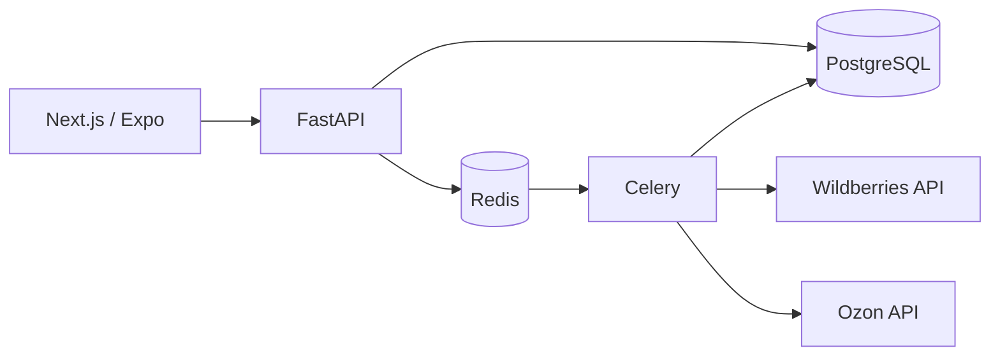

# Архитектура PERK

## Границы первой версии

Отдельный Python-проект в `D:\code\PERK\BACK`; переносить его внутрь проекта фильмов не нужно.
Модульный монолит: один HTTP API, одна PostgreSQL, отдельный Celery worker и Redis.
Next.js и Expo будут обращаться к одному API. Запрос графика читает нашу базу,
а не ждёт ответа маркетплейса.

На 8 октября 2026: WB, авторизация/MFA, планировщик загрузок, продажи и предварительные
финансы реализованы. Стрелка к Ozon пока показывает будущую интеграцию.
Точный статус модулей и ограничения — [STATUS.md](STATUS.md).

## Слои

- `api`: HTTP-запросы, валидация и ответы; формулы сюда не помещаем.
- `modules`: бизнес-модель и правила конкретной области.
- `integrations`: адаптеры площадок, HTTPX, ограничения, ошибки, пагинация.
- `workers`: фоновые задачи, вызывающие сервисы модулей.
- `db`: сессии и общий реестр SQLAlchemy-моделей для Alembic.

Для будущих модулей пока оставлены Python-пакеты с описанием назначения. По мере реализации
добавляем `router.py`, `schemas.py`, `models.py`, `service.py`; отдельный repository только
если он действительно упрощает работу. Не создаём заглушки API, притворяющиеся готовой функцией.

Синхронные SQLAlchemy-сессии: простые транзакции, переиспользуемые в Celery. Обработчики,
работающие с такой сессией, объявляются обычным `def`, чтобы FastAPI выполнял их вне event loop.
Каждый запрос/задача получает свою сессию; сессии не разделяются между потоками и задачами.

## Начальная схема базы

- `workspaces`: владелец набора магазинов, часовой пояс и валюта.
- `stores`: принадлежность рабочему пространству, площадка, название, активность.
- `sync_runs`: источник, состояние, Celery task ID, даты и счётчик обработанных строк.

Составной внешний ключ не позволяет записать загрузку магазина в чужое рабочее пространство.
Проверки прав пользователей, фильтрация и FORCE RLS дополняют ограничения целостности.
Ключи WB находятся в отдельной store_credentials в зашифрованном виде; основной API
использует ограниченную роль без SUPERUSER/BYPASSRLS.

Миграции запускает отдельный одноразовый контейнер `migrate`, API и worker ждут его успеха.
Запуск API не создаёт таблицы автоматически. Репозиторий не содержит данных магазинов;
подключения и секреты создаются локально.

## Данные на следующих этапах

1. Исходные ответы/отчёты с источником, магазином, временем загрузки и правилами хранения.
2. Нормализованные события заказов, продаж, возвратов, финансов и остатков.
3. Сводки, которые можно пересчитать из исходных данных и версии формул.

Деньги — Decimal / PostgreSQL NUMERIC, никогда float. Моменты времени — UTC с часовым
поясом; исходные бизнес-даты сохраняются отдельно. День отчёта определяется явно
по правилам источника/магазина. Для WB/Ozon исходно планируется RUB и Europe/Moscow.

Защита от дублей будет основана на стабильном идентификаторе события площадки и магазине.
Загрузка по API и импорт файла должны использовать один ключ дедупликации.
Поздние возвраты и корректировки вызывают пересчёт затронутых периодов.

Будущие отчёты включают `updated_at`, полноту периода, доступность показателей и причины пропусков.
Нет данных ≠ ноль. Демонстрационные данные появятся отдельно и будут явно помечены.

## Безопасность и эксплуатация

Сейчас это локальное окружение. Публичный порт API слушает только 127.0.0.1;
база и Redis по умолчанию не опубликованы. Реализованы авторизация/MFA, членство в workspace,
фильтрация по workspace, шифрование API-ключей и запрет логирования секретов.
Финансовые данные и пароли нельзя передавать в обычные логи.

Redis — очередь, не источник истины для истории загрузок. В PostgreSQL хранится состояние задачи;
реализованы идемпотентность, повторы и восстановление прерванных загрузок.
Продуктовый сервер потребует HTTPS, внешних секретов, резервного копирования и проверки восстановления.

## Документация использованных инструментов

- [FastAPI: Docker](https://fastapi.tiangolo.com/deployment/docker/)
- [Pydantic Settings](https://docs.pydantic.dev/latest/concepts/pydantic_settings/)
- [Alembic](https://alembic.sqlalchemy.org/en/latest/tutorial.html)
- [Celery и Redis](https://docs.celeryq.dev/en/stable/getting-started/backends-and-brokers/redis.html)
- [Порядок запуска Docker Compose](https://docs.docker.com/compose/how-tos/startup-order/)
- [uv в Docker](https://docs.astral.sh/uv/guides/integration/docker/)
