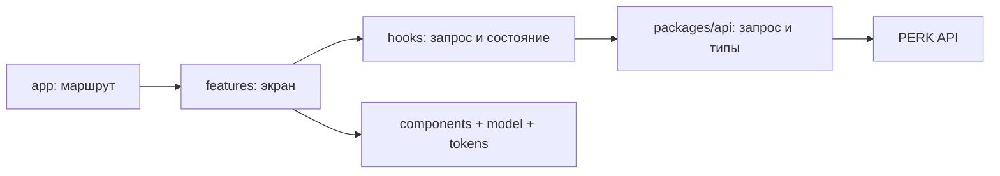

# Архитектура клиентов PERK

Актуально на 5 ноября 2026. Организация по разделам приложения, без отдельного
слоя repositories, универсального конструктора экранов и ручных копий API-типов.

## Карта проекта

```text
apps/mobile/src/
  app/                      маршруты, layouts и защита навигации
  features/
    auth/                   вход, регистрация, MFA, session, stepUp
    workspace/              выбор пространства и магазина, useStoreScope
    overview/               обзор, home, funnel и подготовка графиков
    products/               каталог, варианты, фотографии, себестоимость
    finance/                финансовая сводка, расходы, импорт себестоимости
    inventory/              остатки и список остатков по товарам
    supplies/               рекомендации и оформленные поставки WB/Ozon
    periods/                выбор диапазона и календарь
    stores/                 подключение магазина, замена токена
    team/                   приглашения, роли и доступные магазины
    profile/                профиль и выход
    more/                   меню дополнительных разделов
  components/
    ui/                     общие элементы без расчётов предметной области
    navigation/             PageHeading и ProfileButton
  hooks/                    общие небольшие хуки: debounce, modal, countdown
  lib/                      HTTP, кэш, ETag, даты, форматирование, ошибки
  theme/                    мобильный адаптер общих токенов
apps/mobile/tests/          проверки поведения и расчётов без телефона
packages/
  api/                      OpenAPI, генерация, единый Axios-клиент
  schemas/                  Zod-схемы форм
  tokens/                   общие цвета, размеры, типографика
  constants/                общие постоянные значения
```

Внутри раздела используем только нужные папки:

| Папка        | Что в ней                                                                |
| ------------ | ------------------------------------------------------------------------ |
| `screens`    | Экран целиком, композиция компонентов                                    |
| `components` | Карточки, формы и другие части этого раздела                             |
| `hooks`      | Запросы, мутации и состояние сценария                                    |
| `model`      | Чистые функции: расчёты для отображения, подписи, схемы, типы            |
| `providers`  | Контекст, когда состояние действительно нужно нескольким экранам         |
| `api`        | Ручные операции, которых нет среди обычных JSON-запросов, например файлы |

`overview/home` и `overview/funnel` — части одного раздела; `auth/session` и `auth/stepUp`
сохраняют собственные небольшие модули. Не создаём пустые папки заранее.
Вспомогательная функция для одного файла может оставаться в нём.
Стили остаются рядом с компонентом через `createStyles`; отдельные файлы стилей не требуются.

## Поток данных



1. Экран находится в `features/<раздел>/screens`, маршрут только экспортирует его.
2. Хук использует запросы `@app/api` и TanStack Query; расчёты интерфейса лежат в `model`.
3. Общие запросы остатков и поставок получают выбранный магазин и доступ из
   `workspace/hooks/useStoreScope`. Не отправляют запрос до выбора кабинета и проверки прав.
4. Кэш разделён по пользователю, пространству, магазину, правам, виду запроса и параметрам.
   Не использовать данные предыдущего магазина как placeholder нового.
5. `AppState` связан с Query focusManager в корневом layout: периодический опрос
   приостанавливается в фоне. Скрытые смонтированные вкладки пока могут опрашивать сервер.
6. Долгую загрузку из WB запускает сервер. Экран читает уже сохранённые данные,
   показывает промежуточные снимки и заменяет их целиком при обновлении.

## Типы, деньги и доступ

`pnpm api:generate` копирует `../BACK/docs/openapi.json` и запускает Orval.
Файлы `packages/api/src/generated` не редактируются вручную. `@app/schemas` добавляет
правила форм поверх сгенерированных схем. `packages/tokens` не зависит от React Native.

Деньги приходят decimal-строками; `decimal.js` используется для отображения без потери
точности. Бухгалтерские итоги считает бек. Неизвестное значение не превращается в ноль.
Для аналитики продаж используется воронка WB, для финансов — финансовые отчёты.

Нативная пара access/refresh хранится в SecureStore, web использует cookies/CSRF.
Выход отменяет запросы и очищает сохранённый кэш; поздний refresh предыдущей сессии
не может восстановить её. MFA и step-up проверяет сервер, UI не заменяет проверку прав.
В кэш на диске попадают только запросы с `meta.persist: true`, без OTP, токенов и ключей WB.

Общие элементы выносятся после появления повторения. Крупные новые библиотеки
добавляем только когда они упрощают текущую задачу. Текущие графики используют SVG;
дополнительная библиотека графиков им не нужна.


## Адаптеры Ozon

Каталог/остатки, дневные когорты заказов и нативный запас FBO подключены отдельными адаптерами Ozon. Фоновые запросы выполняет worker-ozon; API читает опубликованные агрегаты. Доступность разделов задаёт `StoreResponse.features`; WB-only расчёты для Ozon отключены. Детали, границы агрегации и следующий этап — [OZON.md](OZON.md).


## Сайт на Next.js

`apps/web` — отдельный браузерный клиент на Next.js App Router, React и TypeScript.
Полная карта и команды запуска: [apps/web/README.md](../apps/web/README.md).
Маршруты тонкие; формы/контексты/запросы находятся в features, доступные элементы
shadcn/ui — в components/ui. Темы берутся из существующего @app/tokens.

`@app/analytics` содержит существующие чистые функции периодов, сводок графика,
форматирования и прав. Mobile сохраняет старые импорты через реэкспорты.
Расчёты одинаковы для обоих клиентов; серверные финансовые формулы и запас
в днях не менялись. Пакет не зависит от React Native или Next.js.

API и схемы форм переиспользуются. Сайт проксирует /api/v1 в текущий FastAPI;
сервер Next.js не дублирует расчёты и не хранит общий кеш пользовательских отчётов.
Браузерные данные отчётов живут в TanStack Query; сессия — HttpOnly cookies/CSRF,
единственный refresh на параллельные 401 и отбрасывание ответов закрытой сессии.
В localStorage только тема, выбранные компания/кабинет и фильтры, без токенов/отчётов.

Реализованы отдельные страницы главной, аналитики, финансов, товаров, остатков,
поставок и настроек. Настройки разделены на кабинеты, команду и профиль.
Общий StepUpProvider подтверждает защищённые действия, useProtectedAction отменяет
запрос при закрытии формы и очищает секреты из сохраняемых ошибок. Запоздалый ответ
закрытого подтверждения не может разрешить другое действие.

Приглашение читается из фрагмента URL на /invite, временно сохраняется только в
sessionStorage и проходит через вход/регистрацию, подтверждение почты и телефона.
Регистрация с invite_code не создаёт дополнительную компанию. Доступ к компании
появляется после серверного принятия приглашения. Смена пароля и общий выход
завершают браузерную сессию и очищают кеш. Секреты кабинетов сервер не возвращает.

В проверках используются unit-тесты, Edge со строго изолированными API-фикстурами,
TypeScript/ESLint и производственная сборка Next.js. Браузерные фикстуры не меняют
реальные кабинеты и не отправляют письма. Приватный проект не опубликован.


Планирование поставок использует нейтральный supplies.service: целевой запас и срок
доставки передаются в общий расчёт WB/Ozon. SupplyPackaging хранит коробную кратность
по workspace/store/native product key с RLS и составным FK на кабинет. Изменение —
owner/admin; чтение — inventory.read с ограничением кабинетов. Экспорт CSV проверяет
inventory.read + reports.export и отдаёт все отфильтрованные строки с no-store.
Клиенты не дублируют финансовые или складские формулы. Общий браузерный помощник
скачивания находится в apps/web/src/lib/download.ts.
